# Gear Wizard

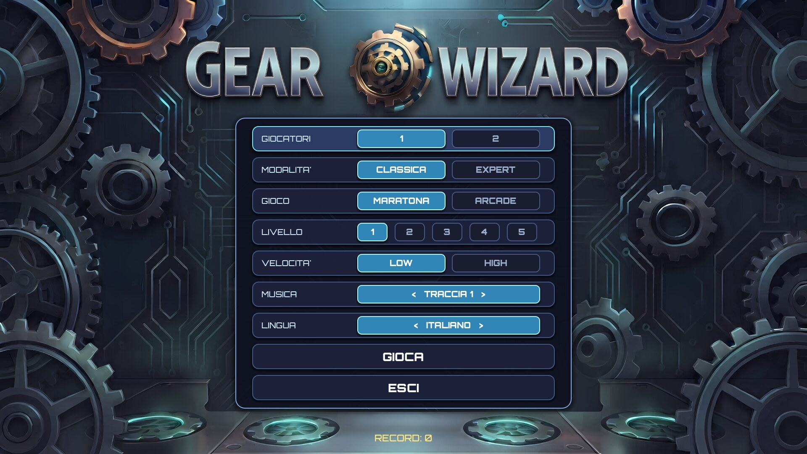

**Gear Wizard** is a falling-pieces puzzle game set in a city of gears. Move, swap and line up the pieces before they reach the top.

**▶ Get the game on itch.io: https://themelooh.itch.io/gear-wizard**

> This page is the game's presentation: description, screenshots and trailer.
> The game itself is distributed only through itch.io.

*[Italiano più sotto](#italiano)*

## Trailer

https://youtu.be/395f08YeeLQ

## The game

Pieces drop from the top of the board two at a time: gears, gems, crescent moons, dragonflies, stone cats and more. You move and swap the pieces so that each one lands where you want it. Line the pieces up to clear them and score; let a column grow past the red line at the top and the game is over. Combos are rewarded with bonus points and an effect on screen.

### Modes

- **1 or 2 players** on the same screen. In two-player matches each player has their own board, side by side, and you can play against a friend or against the **CPU**.
- Two rule sets, **Classic** and **Expert**.
- Two game types, **Marathon** and **Arcade**.
- **5 starting levels** and **two speeds** (Low and High). In two-player matches each player chooses their own level and speed, so players of different skill can compete fairly.
- A **best score is saved for every combination** of modes.

### Presentation

- Illustrated backgrounds of a steampunk city of gears, with piece and combo effects.
- **Selectable music track**, also from the pause menu.
- Languages: **English** and **Italian**.
- The single-player screen shows mode, game type, score, record, level, speed and elapsed time at a glance.

### Controls

- **Player 1**: `W` `A` `S` `D` + `Space`, or gamepad 1.
- **Player 2**: arrow keys + `Enter`, or gamepad 2.
- `Esc` opens the pause menu (resume, restart the match, change music, main menu).

## Screenshots

| | |
|---|---|
| 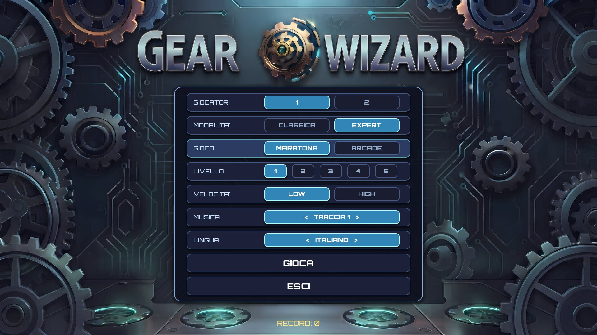 | 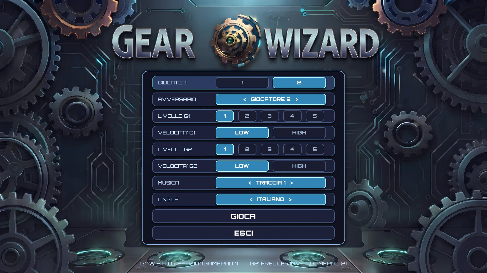 |
| 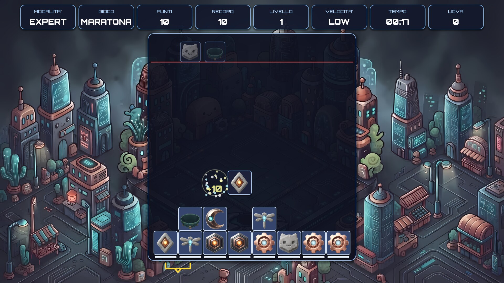 | 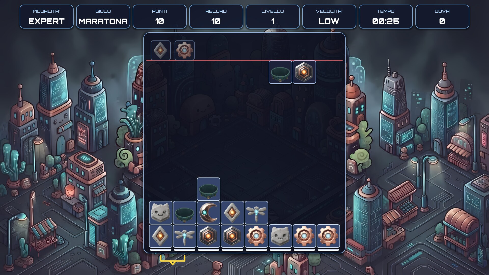 |
| 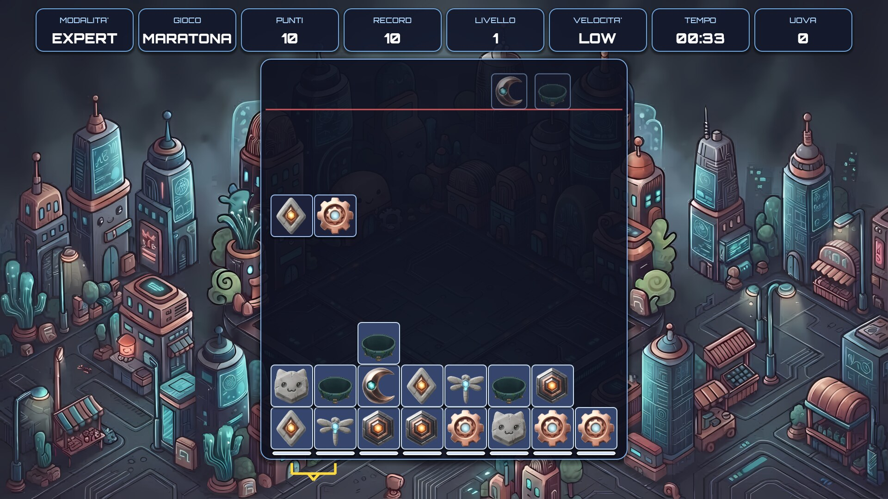 | 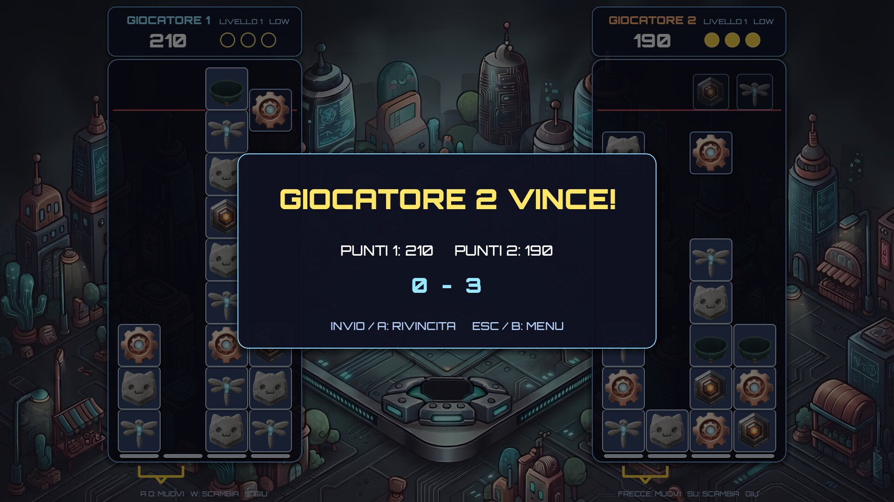 |
| 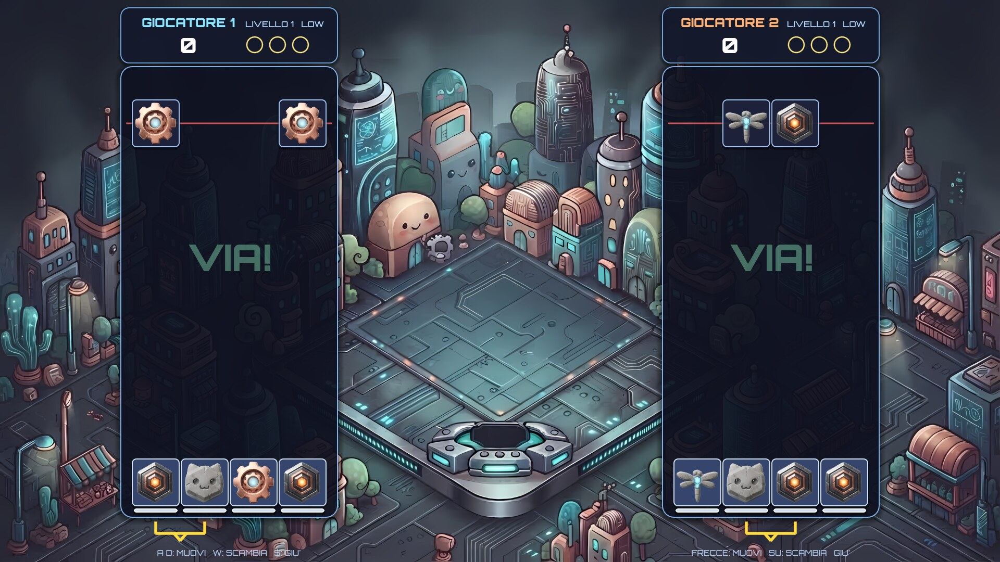 | 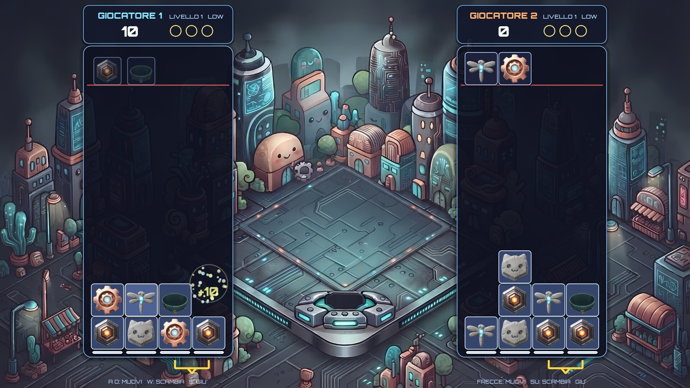 |
| 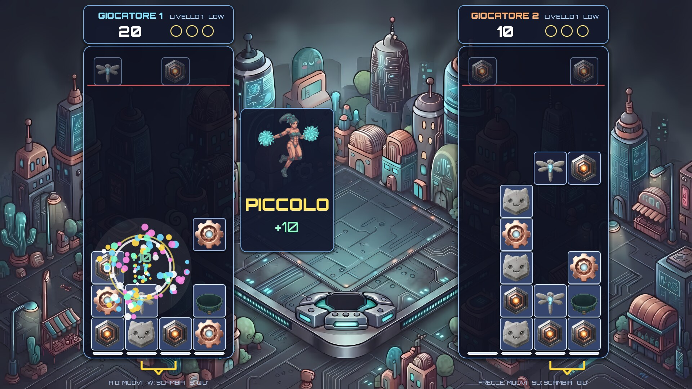 | 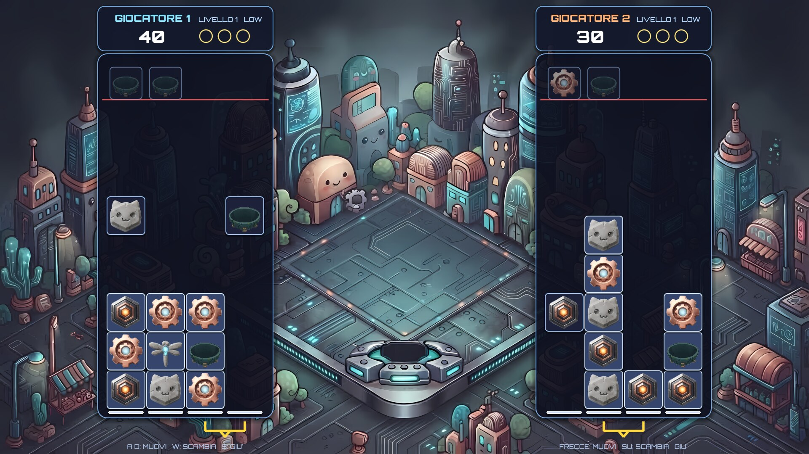 |
| 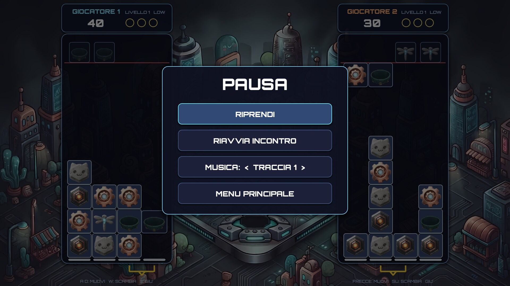 | |

## AI disclosure

Generative AI tools were used in the development of this game and in the writing of this page.

## System requirements

| | Minimum | Recommended |
|---|---|---|
| **OS** | Windows 10 64-bit or Linux 64-bit | Windows 10/11 64-bit or Linux 64-bit |
| **Processor** | Dual-core 2.0 GHz | Dual-core 2.5 GHz or better |
| **Memory** | 4 GB RAM | 4 GB RAM |
| **Graphics** | OpenGL 3.3 compatible | Recent integrated or dedicated graphics card |
| **Storage** | 400 MB | 400 MB |
| **Notes** | Keyboard | Keyboard, or two controllers for two players |

The requirements are estimates. Best scores are saved in the player's personal folder on their own PC.

## Links

- itch.io: https://themelooh.itch.io/gear-wizard
- Trailer: https://youtu.be/395f08YeeLQ

---

# Gear Wizard (italiano)

**Gear Wizard** è un puzzle a incastro con pezzi che cadono, ambientato in una città di ingranaggi. Muovi, scambia e allinea i pezzi prima che arrivino in cima.

**▶ Il gioco è su itch.io: https://themelooh.itch.io/gear-wizard**

> Questa pagina è la presentazione del gioco: descrizione, immagini e trailer.
> Il gioco è distribuito solo tramite itch.io.

## Trailer

https://youtu.be/395f08YeeLQ

## Il gioco

I pezzi scendono dall'alto due alla volta: ingranaggi, gemme, mezzelune, libellule, gatti di pietra e altri. Muovi e scambi i pezzi per far atterrare ognuno dove vuoi. Allinea i pezzi per eliminarli e fare punti; se una colonna supera la linea rossa in alto, la partita finisce. Le combinazioni danno punti extra e un effetto a schermo.

### Modalità

- **1 o 2 giocatori** sullo stesso schermo. In due ognuno ha il proprio campo, fianco a fianco, e si può giocare contro un amico o contro la **CPU**.
- Due regolamenti, **Classica** ed **Expert**.
- Due tipi di gioco, **Maratona** e **Arcade**.
- **5 livelli di partenza** e **due velocità** (Low e High). In due ogni giocatore sceglie il proprio livello e la propria velocità, così anche giocatori di abilità diversa possono sfidarsi alla pari.
- Un **record salvato per ogni combinazione** di modalità.

### Grafica e audio

- Sfondi illustrati di una città steampunk di ingranaggi, con effetti sui pezzi e sulle combinazioni.
- **Musica a scelta**, anche dal menu di pausa.
- Lingue: **italiano** e **inglese**.
- In un giocatore lo schermo mostra a colpo d'occhio modalità, gioco, punti, record, livello, velocità e tempo.

### Comandi

- **Giocatore 1**: `W` `A` `S` `D` + `Spazio`, oppure gamepad 1.
- **Giocatore 2**: frecce + `Invio`, oppure gamepad 2.
- `Esc` apre il menu di pausa (riprendi, riavvia incontro, cambia musica, menu principale).

## Uso dell'intelligenza artificiale

Nello sviluppo di questo gioco e nella scrittura di questa pagina sono stati usati strumenti di intelligenza artificiale generativa.

## Requisiti di sistema

| | Minimi | Consigliati |
|---|---|---|
| **Sistema operativo** | Windows 10 a 64 bit oppure Linux a 64 bit | Windows 10/11 a 64 bit oppure Linux a 64 bit |
| **Processore** | Dual-core 2,0 GHz | Dual-core 2,5 GHz o superiore |
| **Memoria** | 4 GB RAM | 4 GB RAM |
| **Grafica** | Compatibile OpenGL 3.3 | Scheda video integrata recente o dedicata |
| **Spazio su disco** | 400 MB | 400 MB |
| **Note** | Tastiera | Tastiera, oppure due controller per giocare in due |

I requisiti sono stime. I record sono salvati nella cartella personale del giocatore sul suo PC.

---

© TheMelooh. All rights reserved / Tutti i diritti riservati. The text and images on this page may not be reused without permission.
